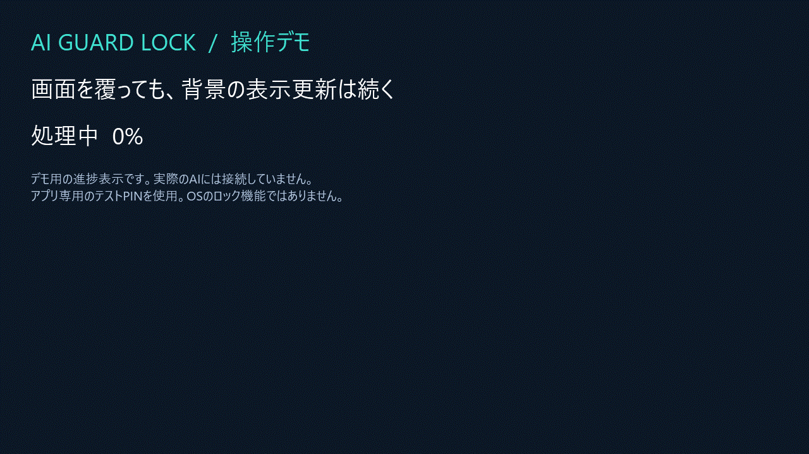
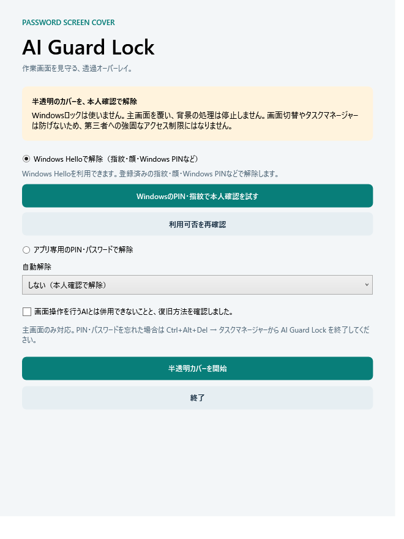

# AI Guard Lock

[English](README.md) · 日本語

1.1.0を公開しました。画面も日英対応です。日本語環境では日本語、それ以外では英語を自動選択します。起動時に`--language=en`または`--language=ja`でも選べます。

**離席中もAIの処理を続けながら、作業画面を半透明で覆う。**

[](https://github.com/Guihakka2/ai-guard-lock/releases/tag/v1.1.0-preview)
[使い方](#すぐ使う) · [質問・要望](https://github.com/Guihakka2/ai-guard-lock/discussions) · [不具合報告](https://github.com/Guihakka2/ai-guard-lock/issues/new?template=bug_report.md)

AI Guard Lockは、サインイン済みのデスクトップを半透明のカバーで覆い、戻ったときにWindows Helloまたはアプリ専用PINで解除するアプリです。バックグラウンドのコード生成・コマンド・API処理を想定しています。

> **OSのロックや強固なアクセス保護の代わりにはなりません。** 背景は見えたままで、タスク切替・プロセス終了は防ぎません。主画面のみを選んだ場合は他のモニターを覆いません。秘密情報を保護したい離席時はOSのロックを使用してください。同じ画面をクリック・入力するAIとも併用できません。

## 画面と操作デモ



約8秒のGIFです。実際のWindows版のカバーを、テスト専用PINで表示・解除しています。背景の進捗はデモ用表示で、実AIの処理やWindows Hello認証を録画したものではありません。

<details>
<summary>設定画面を見る</summary>



設定画面は自動テストで描画したものです。Helloの利用可否は各PCで確認してください。

</details>

## すぐ使う

1. [Releases](https://github.com/Guihakka2/ai-guard-lock/releases)で、自分のOS・CPUに合うファイルを選びます。
2. WindowsはZIPを「すべて展開」し、`AiGuardLock.exe`を開きます。
3. Windows Helloの本人確認を試すか、アプリ専用PIN・パスワードを設定します。Windows版は「カバーする画面」で「主画面のみ」または「すべてのモニター」を選べます。解除は主画面で行います。
4. 注意事項を確認して「半透明カバーを開始」。戻ったら本人確認で解除します。

デスクトップアイコンは同梱の`Create-Desktop-Shortcut.cmd`で作れます。.NET同梱のため、別PCへSDKを入れる必要はありません。Mac・Linuxの手順は[こちら](docs/CROSS-PLATFORM-JA.txt)。

**[1.1.0をダウンロード](https://github.com/Guihakka2/ai-guard-lock/releases/tag/v1.1.0-preview)** — 6種類の配布物とSHA-256を公開しています。MITの`LICENSE.txt`は各配布物に同梱しています。全配布物は未署名、Macは未公証です。実行制限があるPCでは管理者の方針に従ってください。

## 対応OS

| 版 | 解除方法 | 検証状況 |
| --- | --- | --- |
| Windows 11 x64 | Windows Hello / アプリ専用PIN・パスワード | この開発PCで起動・自動検証済み |
| Windows 11 ARM64 | 同上 | ビルド済み、実機未検証 |
| macOS Apple Silicon / Intel | アプリ専用PIN・パスワード | プレビュー、実機未検証・未署名・未公証 |
| Linux x64 / ARM64 | アプリ専用PIN・パスワード | プレビュー、実機未検証 |

Windows・Ubuntu・macOSでビルド、共通40チェックと言語切り替え15チェックが成功しています。[最新の自動テスト結果](https://github.com/Guihakka2/ai-guard-lock/actions/runs/41427580198)。手元のWindowsでは、さらにWPF87チェックと共通アプリの実ウィンドウ日英各8チェックが成功しました。これは各PCの透過合成・物理入力・本人認証の保証ではありません。

## 質問・要望・不具合

| 内容 | 送る場所 |
| --- | --- |
| 使い方の質問、感想、機能の要望 | [Discussions](https://github.com/Guihakka2/ai-guard-lock/discussions) |
| 起動できない、表示がおかしい、解除に失敗する | [Issuesの不具合報告](https://github.com/Guihakka2/ai-guard-lock/issues/new?template=bug_report.md) |
| セキュリティ上の問題 | [Security policy](SECURITY.md)の報告方法 |

不具合報告にはOS・CPU・アプリの版・再現手順を添えてください。PIN・パスワード・トークン・仕事の画面や個人情報は投稿しないでください。返信時間の保証はありません。

改善に参加する方は[貢献ガイド](CONTRIBUTING.md)・[行動規範](CODE_OF_CONDUCT.md)、支援技術に関する制限は[アクセシビリティ案内](ACCESSIBILITY.md)をご覧ください。コードは[MIT License](LICENSE)です。外部依存のライセンスは別途同梱しています。

以下は詳しい操作手順と開発者向け情報です。

## 別のPCへ持っていく

`dist/AI-Guard-Lock-1.1.0-win-x64.zip` をコピーして、移動先で「すべて展開」→ `AiGuardLock.exe` を起動します。Intel/AMDのWindows 11 PC向けです。Snapdragon等のARM PCには `dist/AI-Guard-Lock-1.1.0-win-arm64.zip` を使用してください。

.NET同梱の単一EXEなので、移動先へSDK・.NETを別途インストールする必要はありません。元のPCの.lnkだけをコピーする方法では動きません。移動先のデスクトップアイコンは、同梱の `Create-Desktop-Shortcut.cmd` またはEXEの右クリックメニューから作成できます。

Windows Helloは移動先のPC・ユーザーのPINや生体認証を使います。認証情報は配布物に含めません。利用前に、そのPCで本人確認テストを行ってください。配布版は未署名です。会社の端末で実行が制限される場合は管理者へ確認してください。

配布手順の全文は [PORTABLE-JA.txt](docs/PORTABLE-JA.txt)、検証範囲は [RELEASE.md](docs/RELEASE.md) を参照してください。

## アイコン

青緑のシールドと鍵穴のデザインを、EXE・ウィンドウ・ショートカットに組み込んでいます。`src/AiGuardLock/Assets/AppIcon.ico` は16/24/32/48/64/128/256pxを収録。編集用SVGと512px PNGも同じフォルダーにあります。

アイコンは `scripts/create-icon.ps1` から再生成できます。配布ZIPの再生成は `scripts/publish.ps1 -Runtime win-x64` または `-Runtime win-arm64`。既存配布物を誤って上書きしないよう、同じバージョンの出力がある場合は停止します。

## 詳しい使い方

1. 配布ZIPを展開し、`AiGuardLock.exe` を開きます。
2. 「WindowsのPIN・指紋で本人確認を試す」を押し、表示されたWindowsの画面で認証します。事前チェックが利用不可でも試せます。成功すると「Windows Helloで解除」が選択されます。アプリ専用PINを使う場合はそちらを選び、数字PIN（半角4〜12桁）またはパスワード（8〜128文字）を2回入力します。
3. 注意事項の確認にチェックを入れ「半透明カバーを開始」を押します。
4. 戻ったら「Windows Helloで解除」を押し、Windowsの本人確認ダイアログで認証します。アプリ専用PINを選んだ場合は、同じPIN・パスワードを入力して「解除」またはEnterを押します。

Windows Helloは、現在Windowsにサインインしているユーザーの登録済みの指紋・顔・Windows PINなどを利用します。利用できる方法はPCの構成と組織のポリシーによってWindowsが提示します。アプリは生体情報やWindowsのPINを受け取らず、確認結果だけを受け取ります。キャンセル・失敗では解除しません。

アプリ専用PINはWindows PINとは別です。今回のカバー表示中だけ有効で、ファイルには保存しません。Helloモードではアプリ専用PINの設定は不要です。

Windows Helloが利用できない場合は、そのPCのサインイン設定を確認してください。テストボタンはWindowsへ直接本人確認を要求し、成功結果が返った場合だけHelloモードを有効にします。テストではカバーを開始しません。失敗時は結果を設定画面に表示します。

初期設定は自動解除なし。任意で2分・10分・60分の自動解除も選べます。カバー中のEsc、Alt+F4、通常のウィンドウ終了要求では解除しません。画面構成が変わった場合は安全のため解除します。

パスワードを忘れた場合や異常時は、Ctrl+Alt+Del → タスクマネージャーでAI Guard Lockを終了できます。スクリプトから起動した場合は、コマンドラインにAiGuardLock.dllが含まれるdotnet.exeだけを対象にしてください。

## 対応範囲

- Windows版は主画面のみ、またはすべてのモニターを最前面の半透明ウィンドウで覆います。背景の処理を停止する処理はありません。初期値は主画面のみで、選択はアプリを終了するまで保持します。
- バックグラウンドのコード編集・コマンド・API処理を想定しています。各AIでの継続動作は未検証です。
- 同じ画面へのAIのクリック・キー入力もカバーに遮られるため、GUI操作を続ける用途には対応しません。
- 主画面のみを選んだ場合は他のモニターを覆いません。どちらの設定でも画面切替、仮想デスクトップ、タスクマネージャーを封じません。Windows認証と同等のアクセス制御ではありません。
- スリープやWindowsの自動ロック、電源管理ポリシーは変更しません。

## ビルド・テスト

Windows 11 / .NET 10 SDK / WPF。Windows SDKの.NET参照パッケージをnuget.orgから復元します。

```powershell
powershell.exe -NoProfile -ExecutionPolicy Bypass -File .\scripts\dev.ps1 Build
powershell.exe -NoProfile -ExecutionPolicy Bypass -File .\scripts\dev.ps1 Run
powershell.exe -NoProfile -ExecutionPolicy Bypass -File .\scripts\dev.ps1 Test
```

ExecutionPolicyの指定は起動したPowerShellプロセスだけに適用します。組織のポリシーで実行できない場合は、インストール済みSDKのdotnet restore/buildでビルドしてください。

実行ファイルは `src/AiGuardLock/bin/Release/net10.0-windows10.0.22000.0/AiGuardLock.exe`。同じディレクトリのDLL・設定ファイルも必要です。ショートカットを再作成するには、ビルド後に `scripts/create-shortcut.ps1` を実行します。

専用テストランナーで87チェック成功。`dotnet test`は使用しません。詳細は [検証記録](docs/TESTING.md)、設計上の制限は [技術メモ](docs/TECHNICAL-NOTES.md) を参照してください。

SDK・ビルド出力・ショートカットは管理対象外です。

## macOS・Linuxプレビュー

Avaloniaの別アプリで、アプリ専用PINによる主画面カバーを実装しています。Touch ID・OSログイン認証は未対応です。詳細と起動方法は [CROSS-PLATFORM-JA.txt](docs/CROSS-PLATFORM-JA.txt) を参照してください。

```sh
dotnet build AiGuardLock.CrossPlatform.slnx -c Release
dotnet run --project tests/AiGuardLock.CrossPlatform.Tests -c Release
dotnet run --project src/AiGuardLock.CrossPlatform -c Release
```

Windowsで4種類の配布物を生成するには、.NET 10 SDKとPython 3を用意し、`scripts/publish-cross.ps1` を実行します。MacでのDeveloper ID署名・公証は別途必要です。1.1.0のソースはAvalonia 12.1.4に移行し、自動40チェック、言語切り替え15チェックとWindows上のネイティブウィンドウ日英各8チェックを通過しています。macOS・Ubuntu上でもビルドと共通40チェック・言語切り替え15チェックが成功しています。実際の透過表示・画面操作は未検証です。
