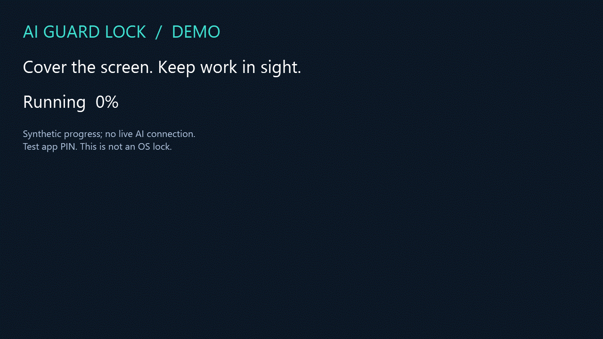
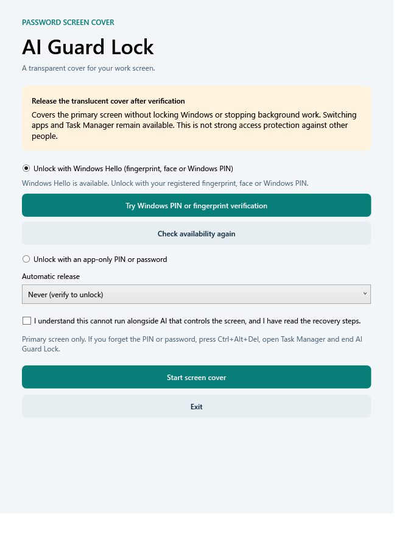

# AI Guard Lock

**Step away. Keep your work in sight.**

A translucent desktop cover for background coding, builds, and other long-running work. Return with Windows Hello or a temporary app PIN.

[**Download / release status →**](https://github.com/Guihakka2/ai-guard-lock/releases) · [日本語](README.ja.md) · [Questions & ideas](https://github.com/Guihakka2/ai-guard-lock/discussions) · [Report a bug](https://github.com/Guihakka2/ai-guard-lock/issues/new?template=bug_report.md)



Eight seconds, looping. The demo uses the real Windows cover and a test PIN. Background progress is synthetic; it does not demonstrate a live AI service or real Windows Hello authentication.

> **This is a convenience screen cover, not an OS lock or a security boundary.** Your background remains visible. Task switching, other displays, and process termination can bypass it. Use your OS lock to protect access or sensitive information. GUI agents clicking or typing on the same desktop are not supported.

## Try it

English and Japanese UI ship in **1.1.0**, currently being prepared. The existing **1.0.2** release remains available with its original Japanese UI. Check [Releases](https://github.com/Guihakka2/ai-guard-lock/releases) for published downloads.

1. Download the archive matching your OS and CPU.
2. On Windows, extract the complete ZIP and open `AiGuardLock.exe`.
3. Test Windows Hello, or set a temporary app PIN/password.
4. Read the notice, acknowledge the limits, then start the cover.
5. When you return, verify with Windows Hello or enter your app PIN.

.NET is bundled; no development SDK is needed. `Create-Desktop-Shortcut.cmd` creates a Windows desktop icon. Read the bundled English guide for macOS/Linux startup and recovery.

**All binaries are unsigned. macOS bundles are not notarized.** Follow your organization's execution policy. Physical GUI behavior on macOS/Linux/ARM64 remains unverified.

## Pick a build

| System | File identifier | Verification | Status |
| --- | --- | --- | --- |
| Windows 11 Intel / AMD | `win-x64.zip` | Windows Hello or app PIN | Local build and automated UI checks |
| Windows 11 ARM64 | `win-arm64.zip` | Windows Hello or app PIN | Build; physical ARM64 GUI unverified |
| macOS Apple Silicon | `osx-arm64-preview.zip` | App PIN/password | Preview; unsigned and unnotarized |
| macOS Intel | `osx-x64-preview.zip` | App PIN/password | Preview; unsigned and unnotarized |
| Linux Intel / AMD | `linux-x64-preview.tar.gz` | App PIN/password | Preview; X11/XWayland with compositing |
| Linux ARM64 | `linux-arm64-preview.tar.gz` | App PIN/password | Preview; physical GUI unverified |

Each archive has a SHA-256 sidecar. New 1.1.0 packages include the project MIT license, runtime licenses, and dependency notices.

## English and Japanese

Japanese display-language systems use Japanese; other systems use English. Both languages are in the same build. Explicitly select a language at launch:

```powershell
.\AiGuardLock.exe --language=en
.\AiGuardLock.exe --language=ja
```

```sh
# Linux
./launch.sh --language=en
# macOS, from the extracted folder
open "AI Guard Lock.app" --args --language=en
```

Windows Hello follows Windows' own language and available sign-in methods. The app does not translate the system authentication dialog.

<details>
<summary>English setup screen</summary>



Rendered in a test session with a substitute Hello service. This does not prove biometric authentication on your PC.

</details>

## Background work and recovery

The cover does not suspend processes. It is intended for command-line tools, builds, code generation, and API requests. It does not change sleep, automatic OS locking, or power policies. Compatibility with every AI tool is unverified. It does not establish that OS locking would stop those tools.

Windows Hello returns a verification result, not your Windows PIN or biometric data. Cancellation and failure do not dismiss the cover. The separate app credential lasts for the current session and is not saved to disk. Do not reuse an important password: managed input strings cannot be guaranteed to disappear from memory.

The cover applies to the primary display only. Ordinary close requests and Esc do not dismiss it. A display-configuration change dismisses it for recovery. On Windows, use **Ctrl+Alt+Del → Task Manager** to end AI Guard Lock if needed. Preview recovery details are in the bundled guide.

## Feedback and development

[Discussions](https://github.com/Guihakka2/ai-guard-lock/discussions) for questions, ideas, and feedback. [Issues](https://github.com/Guihakka2/ai-guard-lock/issues/new?template=bug_report.md) for reproducible bugs. [Security policy](SECURITY.md) for security concerns. Include your OS, CPU, version, and steps; remove credentials, personal paths, and work content.

[Contributing](CONTRIBUTING.md) · [Code of conduct](CODE_OF_CONDUCT.md) · [Accessibility limits](ACCESSIBILITY.md) · [MIT License](LICENSE)

Development requires .NET 10 SDK. Windows WPF builds/tests require Windows. The Avalonia preview shares session logic across platforms.

```sh
dotnet build AiGuardLock.CrossPlatform.slnx -c Release
dotnet run --project tests/AiGuardLock.CrossPlatform.Tests -c Release
dotnet run --project tests/AiGuardLock.Localization.Tests -c Release
```

```powershell
dotnet build AiGuardLock.slnx -c Release
dotnet run --project tests/AiGuardLock.Tests -c Release
```

These are executable test runners, not `dotnet test` projects. UI tests may briefly display a cover. Automated checks do not replace physical testing of transparency, focus, input, or real Hello authentication.
