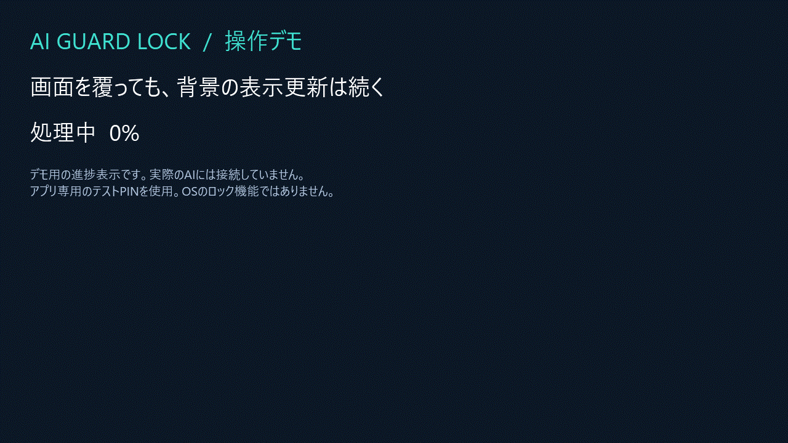

# WPFの半透明カバーにWindows HelloとセッションPINを組み合わせた実装メモ

AIのコード生成やコマンドを背景で進めながら、主画面を半透明で覆う **AI Guard Lock** を作りました。この記事では、画面のカバーと本人確認をどう分けたか、Windows Helloの結果の扱い、PIN照合の実装、自動テストの範囲を紹介します。

ソース: https://github.com/Guihakka2/ai-guard-lock

## 最初に、できることの範囲

このアプリはOSのロックでも、アクセス制御の境界でもありません。半透明なので背景は見え、タスク切替・他のモニター・プロセス終了も防ぎません。機密情報を保護する離席にはOSのロックを使ってください。

また、OSをロックするとあらゆるバックグラウンドAIが停止する、という前提ではありません。カバー自身が背景のプロセスを停止しない設計であり、各AIとの互換性は別の確認です。同じ画面をクリック・入力するAIには、そのカバーが障害になるため対応しません。

## 動作デモ



実際のWPFカバーを表示し、テスト用PINを入力して解除した約8秒のGIFです。背景はデモ用の進捗表示です。実AIとの接続、仕事の画面の録画、Windows Helloの実認証ではありません。

## 1. 透過表示はUIの仕事

カバーはWPFの枠なし・最前面ウィンドウで、主画面のサイズへ合わせています。実際のXAMLは次の属性を使っています。

```xml
WindowStyle="None"
ResizeMode="NoResize"
AllowsTransparency="True"
Background="#700A1422"
Topmost="True"
```

通常のClose要求やEscイベントでそのまま解除しないよう、認証結果やセッション終了の理由を別に管理します。ただし、タスクマネージャーや別デスクトップまで封じる仕組みではありません。この制限はREADMEと画面にも表示しています。

## 2. Windows HelloはOSに委譲する

Windows版は`UserConsentVerifier.CheckAvailabilityAsync()`で利用可否を確認し、実際の確認には所有ウィンドウのハンドル付きで次のAPIを呼びます。

```csharp
await UserConsentVerifierInterop.RequestVerificationForWindowAsync(
    ownerWindow,
    "AI Guard Lock の本人確認を行います。");
```

アプリが受け取るのは確認結果です。Windows PINや指紋データをアプリの入力欄に取り込むわけではありません。成功した場合だけカバーを解除し、キャンセル・失敗・例外では残します。

本人確認の二重起動も抑制します。また、認証待ちの途中でセッションが終了したあとに結果が戻っても、古い画面の状態を変更しないようにしています。事前チェックと実際の認証結果は別なので、設定画面には本人が明示的に試すボタンを用意しました。

## 3. アプリ専用PINはセッション内だけ

Windows PINを使わない場合は、別途アプリ専用PIN・パスワードを設定します。数字は半角4〜12桁、それ以外は空白だけを避けて8〜128文字です。

保存する資格情報は、16バイトのランダムsaltとPBKDF2-SHA256（210,000反復）の32バイト出力です。照合には固定時間比較を使います。実装の中心部分は次のようになっています。

```csharp
Span<byte> candidate = stackalloc byte[32];
try
{
    Rfc2898DeriveBytes.Pbkdf2(
        password, _salt, candidate, Iterations, HashAlgorithmName.SHA256);
    return CryptographicOperations.FixedTimeEquals(_hash, candidate);
}
finally
{
    CryptographicOperations.ZeroMemory(candidate);
}
```

カバー終了時には保持したハッシュとsaltも破棄します。ファイルへ資格情報を保存せず、失敗した入力欄も消去します。誤入力後は1秒の再試行待機があります。

この工夫をしても、4桁PINの探索空間が大きくなるわけではありません。実行中のプロセスを操作できる攻撃者への対策にもなりません。特にmacOS/Linux版の入力文字列はマネージド文字列なので、メモリからの完全消去は保証できません。重要なパスワードは流用しないでください。

## 4. 自動テストの対象を分ける

| 対象 | 結果 |
| --- | --- |
| Windows版の資格情報・UI・Hello代替サービス | 60チェック成功 |
| 共通セッション・ヘッドレスUI | 20チェック成功 |
| Windows上の共通アプリ実ウィンドウ | 4チェック成功 |
| GitHub-hosted Windows・Ubuntu・macOS | 各ビルドと共通20チェック成功 |

Helloの失敗結果、二重起動、終了後の遅延結果、誤PIN、再試行待機、通常終了の拒否などをテストしています。専用ランナーなので`dotnet test`ではなく、次のように実行します。

```powershell
dotnet run --project tests/AiGuardLock.Tests -c Release
dotnet run --project tests/AiGuardLock.CrossPlatform.Tests -c Release
```

Windows版のランナーはWindows上で実行します。実ウィンドウのテストは画面を一時的に覆います。本人の生体認証、画面合成、物理入力、各AIの動作まで自動テストで保証するものではありません。

実行記録: https://github.com/Guihakka2/ai-guard-lock/actions/runs/41396656815

## 配布とフィードバック

Windows x64/ARM64とmacOS/Linux用プレビューを用意しています。全配布物は未署名、Macは未公証です。配布状況は[Releases](https://github.com/Guihakka2/ai-guard-lock/releases)で確認してください。1.0.2は記事作成時点では公開準備中です。

ソースはMIT Licenseです。改善案は[Discussions](https://github.com/Guihakka2/ai-guard-lock/discussions)、不具合は[Issues](https://github.com/Guihakka2/ai-guard-lock/issues/new?template=bug_report.md)へお願いします。PINや仕事の画面などを公開投稿しないでください。
