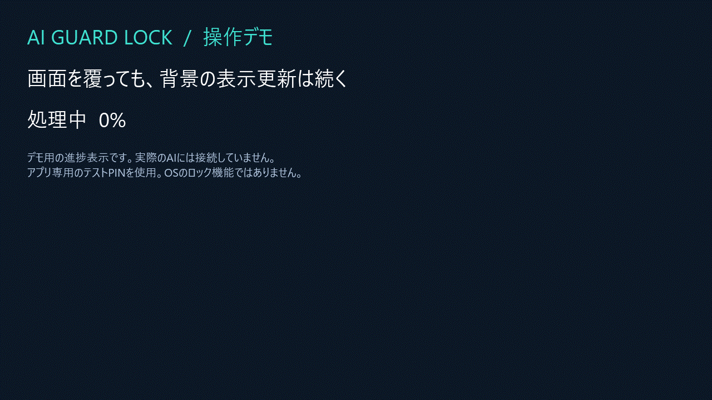

AIにコード生成や長いコマンドを任せているとき、処理の状況を画面に残しながら、デスクトップにカバーをかけたい。そんな用途で **AI Guard Lock** を作りました。

Windowsのロック画面へ切り替えず、主画面を半透明のウィンドウで覆い、戻ったときにWindows Helloかアプリ専用PINで解除します。

> これはOSのロックや強固なアクセス保護の代わりではありません。背景は見え、タスク切替・別モニター・プロセス終了は防ぎません。秘密情報を保護する離席にはOSのロックを使ってください。また、OSロックであらゆるAIの処理が止まると主張するものでもありません。

https://github.com/Guihakka2/ai-guard-lock

## まず動きを見る

約8秒のGIFです。実際のWindows版のカバーをテスト用PINで表示・解除しています。背景の進捗はデモ用で、実AIの処理やWindows Helloの実認証を録画したものではありません。仕事の画面や通知は収録していません。

## 想定した使い方

コード生成、ビルド、コマンド、APIリクエストなど、背景で進む処理を想定しています。カバー自身はそれらのプロセスを停止する処理を行いません。

一方、AIが同じ画面をクリックしたり文字入力したりする用途には使えません。その操作もカバーに遮られます。各AIサービスでの継続動作を網羅して確認したわけではありません。スリープやWindowsの自動ロック、組織の電源管理設定も変更しません。

## 試す手順

[1.0.2のGitHub Release](https://github.com/Guihakka2/ai-guard-lock/releases/tag/v1.0.2-preview)からダウンロードできます。Windows・Mac・Linuxの各x64/ARM64、計6種類と各ハッシュを公開しています。MITの`LICENSE.txt`も併せて取得してください。

Windowsは対応するCPUのZIPを展開して`AiGuardLock.exe`を起動します。.NETを同梱しているためSDKの追加は不要です。アイコンは`Create-Desktop-Shortcut.cmd`から作れます。

1. Windows Helloの本人確認を試すか、アプリ専用PIN・パスワードを設定する。
2. 注意事項を確認して、半透明カバーを開始する。
3. 戻ったらWindowsの本人確認、または設定したPINで解除する。

全配布物は未署名です。Macは未公証なので、組織の端末で使う場合は実行ポリシーに従ってください。

## 画面を覆う処理と、認証を分けた

Windows版はWPF、共通ロジックは.NET、macOS/Linux用プレビューはAvaloniaです。Windows版のカバーは最前面・枠なし・透過ウィンドウですが、その表示属性を認証の強さと同じものとして扱わないようにしました。

Windows HelloはWindows側の本人確認へ委譲します。アプリが受け取るのは確認結果で、Windows PINや生体情報そのものを収集しません。確認のキャンセル・失敗では解除しない設計です。

アプリ専用PINは別の仕組みです。数字4〜12桁、または8〜128文字のパスワードを、そのカバーのセッション中だけ使います。資格情報をファイルへ保存せず、誤入力後には再試行待機を設けています。ただし、短いPINやプロセス内の状態は、実行中のPCを制御できる相手への防御にはなりません。

## 確認したこと、まだ確認していないこと

Windows上のWPF60チェック、共通ヘッドレス20チェック、共通アプリの実ウィンドウ4チェックが成功しています。GitHub-hosted Windows・Ubuntu・macOSでもビルドと共通20チェックを実行しました。

https://github.com/Guihakka2/ai-guard-lock/actions/runs/41396656815

Mac/Linux/ARM64の実機GUI、各PCでの本人認証、署名・公証は別の確認です。自動テストの成功を、全環境での安全性・操作互換性の保証とは扱っていません。macOS/Linuxはプレビューとして案内しています。

## 感想・改善案をください

コードはMIT Licenseです。質問や使ってみた感想、機能の要望は[Discussions](https://github.com/Guihakka2/ai-guard-lock/discussions)、不具合は[Issues](https://github.com/Guihakka2/ai-guard-lock/issues/new?template=bug_report.md)へお願いします。

報告にはOS・CPU・バージョン・再現手順を添えてください。PINやパスワード、仕事の画面は投稿しないでください。用途が合いそうなら、READMEの制限も確認したうえで試してもらえるとうれしいです。
